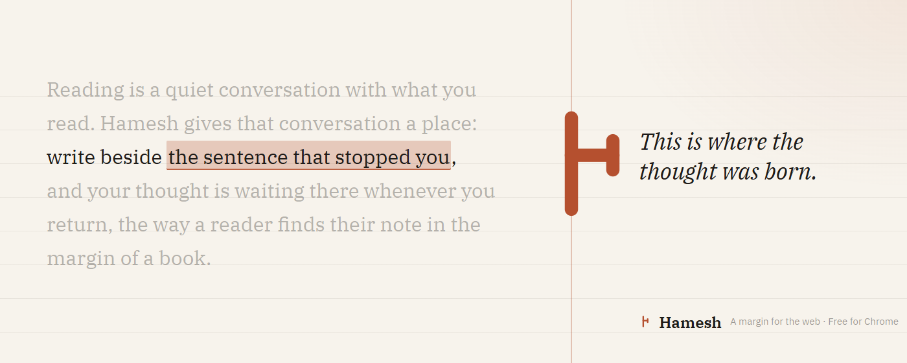
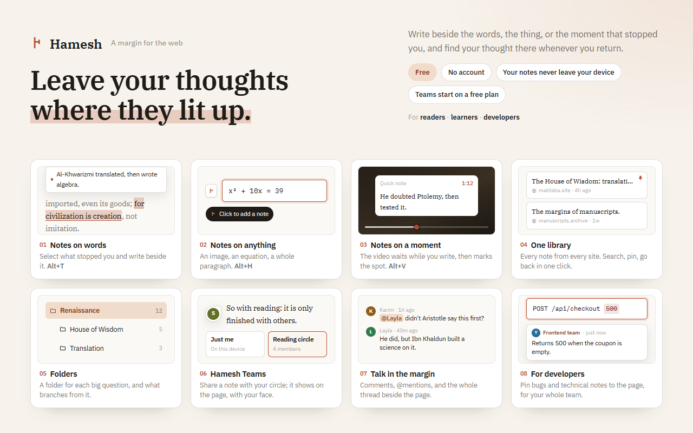
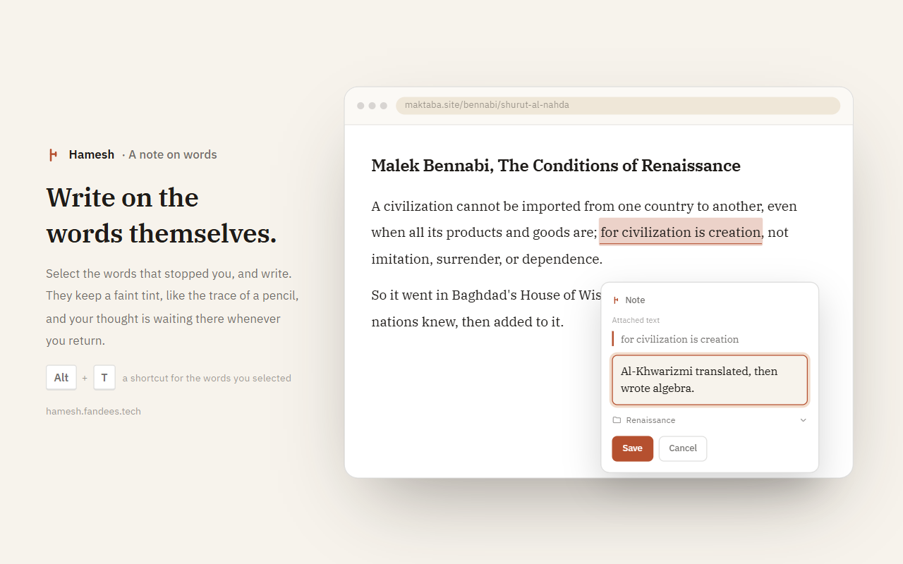
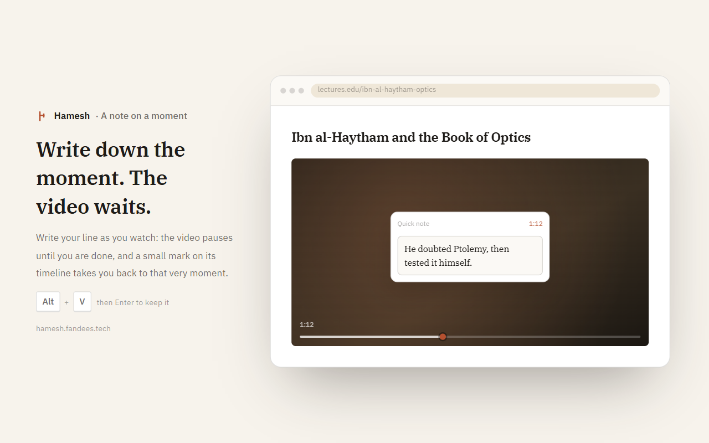
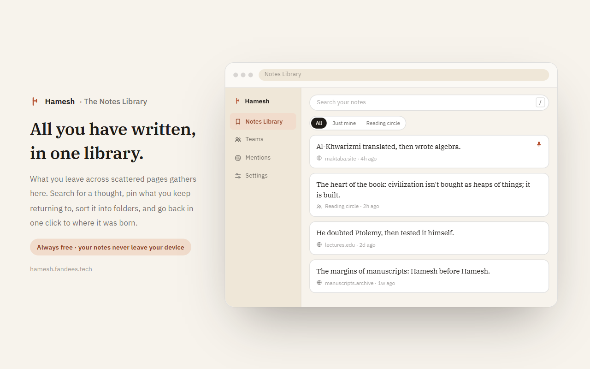
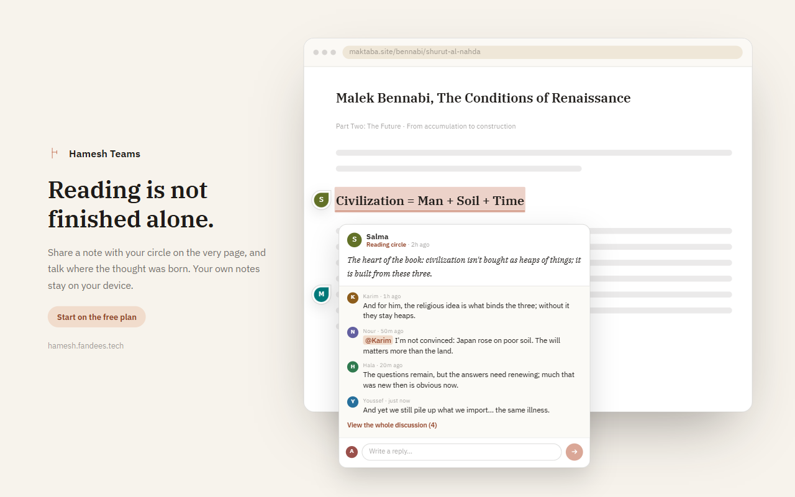

<p align="center">
  
</p>

<h1 align="center">Hamesh — هامش</h1>

<p align="center">
  <b>Leave your thoughts where they lit up.</b><br />
  A margin for the web: write beside the words, the thing, or the moment that stopped you,<br />
  and find your thought there whenever you return.
</p>

<p align="center">
  <a href="https://chromewebstore.google.com/detail/hamesh-%E2%80%94-%D9%87%D8%A7%D9%85%D8%B4/giajamkkehcoienhhlcfgcckahjjbgnc"></a>
  <a href="https://chromewebstore.google.com/detail/hamesh-%E2%80%94-%D9%87%D8%A7%D9%85%D8%B4/giajamkkehcoienhhlcfgcckahjjbgnc"></a>
  <a href="https://github.com/mohammed-fandees/hamesh/actions/workflows/ci.yml"></a>
  <a href="LICENSE"></a>
</p>

<p align="center">
  <a href="https://chromewebstore.google.com/detail/hamesh-%E2%80%94-%D9%87%D8%A7%D9%85%D8%B4/giajamkkehcoienhhlcfgcckahjjbgnc"><b>Add to Chrome</b></a>
  ·
  <a href="https://hamesh.fandees.tech">Website</a>
  ·
  <a href="https://www.youtube.com/watch?v=v-Kum8qhSUc">Watch the video</a>
  ·
  <a href="https://hamesh.fandees.tech/privacy.html">Privacy</a>
</p>

<p align="center">
  
</p>

Books and manuscripts have always had margins: a quiet place where readers leave thoughts,
questions, and connections. _Hamesh_ is the Arabic word for that margin, and this extension
brings it to the web. Instead of losing ideas in a separate app, attach them to the exact words,
element, or moment in a video that inspired them. When you come back, they are waiting exactly
where you left them.

## What's new

- **Hamesh Teams** (2.0). Read together: share a note on the page for your team to see, with your
  picture beside it, and discuss it right there with replies and @mentions, or in Chrome's side
  panel. Optional, off until you turn it on.
- **Teams starts on a free plan** (2.0.3). Sign in with Google and you're on it. No payment, no
  button.
- **The video waits while you write** (1.4). A quick note pauses the video and plays it again when
  you're done, on YouTube and any HTML5 player.
- **File as you write** (1.4). Pick a note's folder in the composer, and make it the default for a
  page or for every page.
- **Notes on exact words** (1.3). Select text, click the small mark beside it, and write. The words
  keep a faint tint, and your note comes back when you pass over them.

Every release is in the [changelog](CHANGELOG.md).

## See it in action

<p align="center">
  <a href="https://www.youtube.com/watch?v=v-Kum8qhSUc">
    
  </a>
  <br />
  <sub><a href="https://www.youtube.com/watch?v=v-Kum8qhSUc">▶ Stop Losing Ideas in Closed Tabs: Notes That Live on the Page</a></sub>
</p>

## Features

<p align="center">
  
</p>

### Write on the words themselves

Select the words that stopped you, click the small mark that appears beside them, and write. They
keep a faint tint, like the trace of a pencil, and your note is waiting there whenever you return,
even if the page has moved them. Shortcut: <kbd>Alt</kbd>+<kbd>T</kbd>.



### Point at the thing itself

Not every thought belongs to words. Press <kbd>Alt</kbd>+<kbd>H</kbd>, move across the page, and
Hamesh frames whatever is under the pointer: an image, an equation, a whole paragraph. Click it and
write. Nothing to draw, no screenshot to keep.

### Write down the moment, the video waits

While you watch a lesson or a talk, press <kbd>Alt</kbd>+<kbd>V</kbd> and write your line. The video
pauses until you're done, and a small mark on its timeline takes you back to that very moment.



### Everything you've written, in one library

Notes from every site gather in the Notes Library, grouped by website or sorted into your own
folders. Search instantly, pin what you return to, and go back in one click to where each thought
was born. Edit, delete, or move any note without reopening its page.



### Read together with Hamesh Teams

Choose who a note is for: just you, or your team. A shared note shows on the very page it belongs
to, with your picture beside it. Talk in the margin with replies and @mentions, see where you were
named in **Mentions**, or open the whole discussion in Chrome's side panel. Teams is optional, uses
Google sign-in, and starts on a free plan.



### And the details

- **Arabic and English**, right to left and left to right, following Chrome's language or your own
  choice.
- **Light, dark, or match the website**: Hamesh's own UI only; the page itself is never touched.
- **Backup** your notes and folders to a JSON file you own, and restore them from it.
- **Rebindable shortcuts** in Chrome's own shortcuts page.

## Privacy

Your personal notes stay on your device, in your browser's own extension storage: no account, no
analytics, and nothing sent anywhere. **Hamesh Teams is the only exception**: once you turn it on
and sign in, only what you choose to share goes to the Hamesh Teams server. The full details are in
[PRIVACY.md](PRIVACY.md) and on the [website](https://hamesh.fandees.tech/privacy.html).

## Install

**[Add Hamesh to Chrome](https://chromewebstore.google.com/detail/hamesh-%E2%80%94-%D9%87%D8%A7%D9%85%D8%B4/giajamkkehcoienhhlcfgcckahjjbgnc)** from the Chrome Web Store. Then, on any page,
click the Hamesh icon or press <kbd>Alt</kbd>+<kbd>H</kbd>.

---

## Development

> Hamesh is proprietary software. This section is for authorized contributors; see
> [CONTRIBUTING.md](CONTRIBUTING.md) and [License](#license).

### Tech stack

| Layer      | Choice                                                              |
| ---------- | ------------------------------------------------------------------- |
| Framework  | [WXT](https://wxt.dev) (browser extension tooling), MV3             |
| UI         | React 19, mounted in an isolated Shadow DOM on web pages            |
| Language   | TypeScript (strict)                                                 |
| Styling    | Design tokens (CSS custom properties) in `src/ui/tokens.css`        |
| Teams wire | Zod schemas in [`packages/teams-contract`](packages/teams-contract) |
| Unit tests | Vitest                                                              |
| E2E tests  | Playwright, driving the real extension                              |

### Getting started

Requires Node 20+ and pnpm.

```bash
pnpm install
pnpm dev            # WXT dev server with hot reload
```

To load a build in Chrome:

```bash
pnpm build          # output → .output/chrome-mv3/
```

Open `chrome://extensions`, turn on **Developer mode**, choose **Load unpacked**, and select
`.output/chrome-mv3/`.

### Two builds

The repo ships two builds from one source:

- **Store build:** no Teams configuration.
- **Teams build:** set `WXT_TEAMS_API_ORIGIN` and `WXT_GOOGLE_CLIENT_ID` in `.env.local`.

Teams code is gated by a build-time constant, so a build without those values carries none of it.
See [docs/teams-client.md](docs/teams-client.md#build-configuration). The Teams server lives in a
separate, private repository.

### Scripts

| Command         | What it does                                                |
| --------------- | ----------------------------------------------------------- |
| `pnpm dev`      | Dev server with hot reload                                  |
| `pnpm build`    | Production build to `.output/chrome-mv3/`                   |
| `pnpm zip`      | Packaged `.zip` for the Chrome Web Store                    |
| `pnpm test`     | Unit and integration tests (Vitest)                         |
| `pnpm test:e2e` | End-to-end tests against the real extension (Playwright)    |
| `pnpm check`    | Typecheck, lint, format check, unit tests and build         |
| `pnpm assets`   | Regenerate the extension icons and the social preview image |

### Project structure

```
src/
├── domain/       # Pure logic: notes, page keys, anchors, preferences, library grouping
├── storage/      # Repositories over chrome.storage.local
├── content/      # The on-page app: orchestration, theme detection, navigation, positioning
├── ui/           # React components and design tokens (composer, viewer, library, settings, teams)
├── teams/        # Teams client: API, sign-in, sync, realtime, the page channel
├── messaging/    # Runtime message types
└── entrypoints/  # WXT entrypoints: content script, background, popup, Notes Library
packages/
└── teams-contract/  # The Teams wire contract, shared with the server
landing/             # The website, hamesh.fandees.tech
docs/                # Architecture, engineering rules, releasing, the Chrome Web Store package
```

Everything Hamesh draws on a web page lives in one Shadow DOM root, so its styles never leak into
the page, and the page's never leak in.

### Testing

```bash
pnpm test           # unit and integration
pnpm test:e2e       # end to end
pnpm check          # the full gate
```

The E2E suite builds the extension, serves its fixtures over HTTP (content scripts don't run on
`file://`), and launches Chromium with `--headless=new`, since legacy headless can't load
extensions. CI runs it on every pull request, alongside typecheck, lint, format, unit tests and
the build.

### Documentation

- [docs/ENGINEERING-RULES.md](docs/ENGINEERING-RULES.md): the rules every change follows. Read it
  first.
- [docs/architecture.md](docs/architecture.md): runtime contexts, data flow, anchoring, SPA support.
- [docs/DESIGN-AND-LAYOUT.md](docs/DESIGN-AND-LAYOUT.md): the design system and layout rules.
- [docs/teams-client.md](docs/teams-client.md): the Teams client and its build configuration.
- [docs/RELEASING.md](docs/RELEASING.md): versioning and the release process.
- [docs/chrome-web-store/](docs/chrome-web-store/): the store listing, its graphics, and how
  they're made.

### Releases

Semantic Versioning. Releases are cut from `main` by pushing a `vMAJOR.MINOR.PATCH` tag, which builds
and publishes the extension through GitHub Actions. See [docs/RELEASING.md](docs/RELEASING.md) and
the [changelog](CHANGELOG.md).

## License

Proprietary. All rights reserved. See [LICENSE](LICENSE). This is **not** open-source software.
[CONTRIBUTING.md](CONTRIBUTING.md) · [SECURITY.md](SECURITY.md) · [PRIVACY.md](PRIVACY.md)
