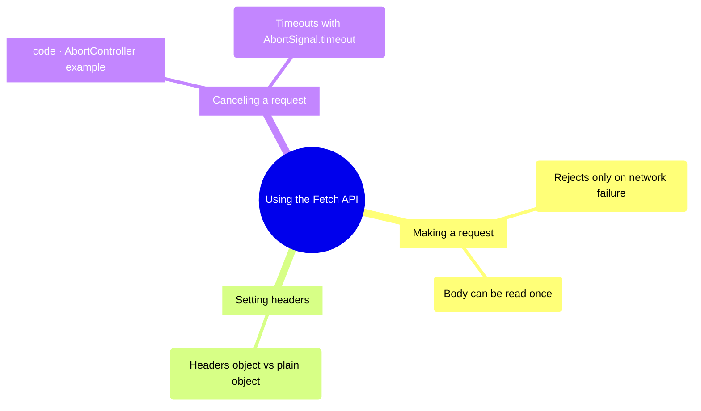

# Using the Fetch API

|              |                                                                                                 |
| ------------ | ----------------------------------------------------------------------------------------------- |
| Source       | [developer.mozilla.org](https://developer.mozilla.org/en-US/docs/Web/API/Fetch_API/Using_Fetch) |
| Kind         | Article                                                                                         |
| Notes        | 5                                                                                               |
| Last written | 9 November 2026                                                                                 |
| Folder       | [Work / Frontend](../../Folders/Work/Frontend.md)                                               |

## Map of the page

## Making a request

> the promise only rejects when the request itself fails

A 404 still resolves. Always check `response.ok` before `.json()`.

> a response body is a stream and can be consumed only once

Need it twice? `response.clone()` before reading.

## Setting headers

> you can pass a Headers object or an object literal

Headers object normalises names to lower case. Matters when I merge defaults in our client.

## Canceling a request

**On a code block** · "const controller = new AbortController()…"

Use this pattern in the search box: abort the previous request on every keystroke.

> AbortSignal.timeout() returns a signal that aborts after a set time

Cleaner than a setTimeout + abort pair. Check Safari support before using it.

---

Exported from [Hamesh](https://hamesh.fandees.tech) · 20 November 2026
