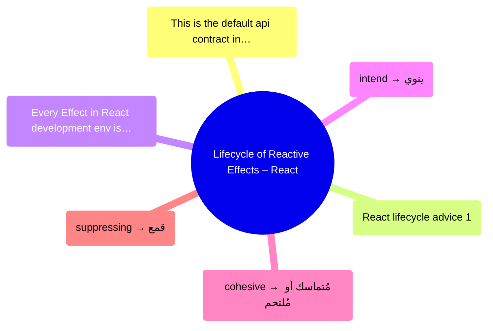

# Lifecycle of Reactive Effects – React

| الخاصية | القيمة |
|---|---|
| المصدر | [react.dev](https://react.dev/learn/lifecycle-of-reactive-effects) |
| النوع | مقال |
| طريقة العرض | ملاحظات |
| الملاحظات | 6 |
| آخر ملاحظة | 22 أغسطس 2026 |
| الفولدر | [Learning / React](../../Folders/Learning/React.md), [English - Vocab](../../Folders/English%20-%20Vocab.md) |

## خريطة الصفحة

## نظرة سريعة

| # | على | الملاحظة |
|---|---|---|
| 1 | connection.disconnect(); | This is the default api contract in useEffect: useEffect should only return… |
| 2 | When you looked from the component’s perspective, it was… | React lifecycle advice #1 |
| 3 | React starts and stops your Effect one extra time in… | Every Effect in React development env is done twice |
| 4 | intend | ينوي |
| 5 | cohesive | مُتماسك أو مُلتحم |
| 6 | suppressing | قمع |

## الملاحظات

> connection.disconnect();

This is the default api contract in useEffect: useEffect should only return undefined or a function.

> When you looked from the component’s perspective, it was tempting to think of Effects as callbacks.

React lifecycle advice #1

> React starts and stops your Effect one extra time in development

Every Effect in React development env is done twice

> intend

ينوي

> cohesive

مُتماسك أو مُلتحم

> suppressing

قمع

---

*صُدِّرت من [هامش](https://hamesh.fandees.tech) · 20 نوفمبر 2026*
