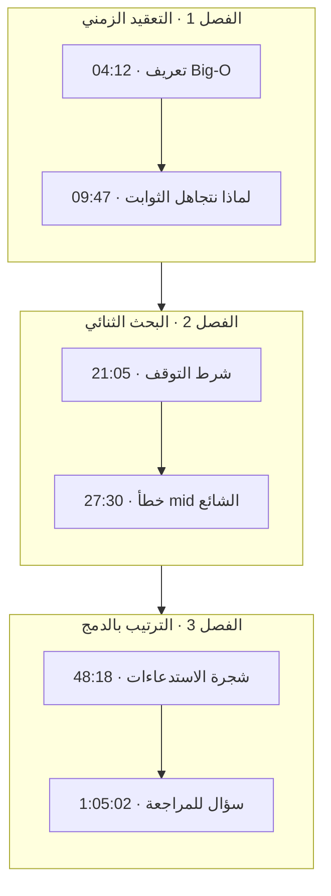

# مقدمة في الخوارزميات — المحاضرة 3

|            |                                                            |
| ---------- | ---------------------------------------------------------- |
| المصدر     | [youtube.com](https://www.youtube.com/watch?v=Qx7aL2mP9dE) |
| النوع      | فيديو · 1:12:40                                            |
| الملاحظات  | 6                                                          |
| آخر ملاحظة | 18 نوفمبر 2026                                             |
| المجلد     | [Algorithms](../../Folders/Algorithms.md)                  |

## الخط الزمني

## نظرة سريعة

| الوقت                                          | الفصل          | الملاحظة             |
| ---------------------------------------------- | -------------- | -------------------- |
| [04:12](https://youtu.be/Qx7aL2mP9dE?t=252)    | التعقيد الزمني | تعريف Big-O          |
| [09:47](https://youtu.be/Qx7aL2mP9dE?t=587)    | التعقيد الزمني | لماذا نتجاهل الثوابت |
| [21:05](https://youtu.be/Qx7aL2mP9dE?t=1265)   | البحث الثنائي  | شرط التوقف           |
| [27:30](https://youtu.be/Qx7aL2mP9dE?t=1650)   | البحث الثنائي  | خطأ mid الشائع       |
| [48:18](https://youtu.be/Qx7aL2mP9dE?t=2898)   | الترتيب بالدمج | شجرة الاستدعاءات     |
| [1:05:02](https://youtu.be/Qx7aL2mP9dE?t=3902) | الترتيب بالدمج | سؤال للمراجعة        |

## الفصل 1 · التعقيد الزمني

### تعريف Big-O

[▶ 04:12](https://youtu.be/Qx7aL2mP9dE?t=252)

Big-O بيوصف أسوأ نمو للخطوات مع كبر المدخلات، مش الوقت بالثواني.
مثال الدكتور: حلقتين متداخلتين = O(n²).

### لماذا نتجاهل الثوابت

[▶ 09:47](https://youtu.be/Qx7aL2mP9dE?t=587)

3n و 100n نفس الرتبة. اللي يفرق لما n تكبر هو شكل الدالة نفسه.

## الفصل 2 · البحث الثنائي

### شرط التوقف

[▶ 21:05](https://youtu.be/Qx7aL2mP9dE?t=1265)

`while (low <= high)` مش `<`، وإلا هيفوّت آخر عنصر.

### خطأ mid الشائع

[▶ 27:30](https://youtu.be/Qx7aL2mP9dE?t=1650)

`(low + high) / 2` ممكن يعمل overflow في لغات بأعداد محدودة.
الأسلم: `low + (high - low) / 2`.

## الفصل 3 · الترتيب بالدمج

### شجرة الاستدعاءات

[▶ 48:18](https://youtu.be/Qx7aL2mP9dE?t=2898)

عمق الشجرة log n، وكل مستوى بيعمل n شغل → O(n log n).

### سؤال للمراجعة

[▶ 1:05:02](https://youtu.be/Qx7aL2mP9dE?t=3902)

ليه merge sort محتاج ذاكرة إضافية O(n) والـ quicksort لأ؟

---

صُدِّرت من [هامش](https://hamesh.fandees.tech) · 20 نوفمبر 2026
