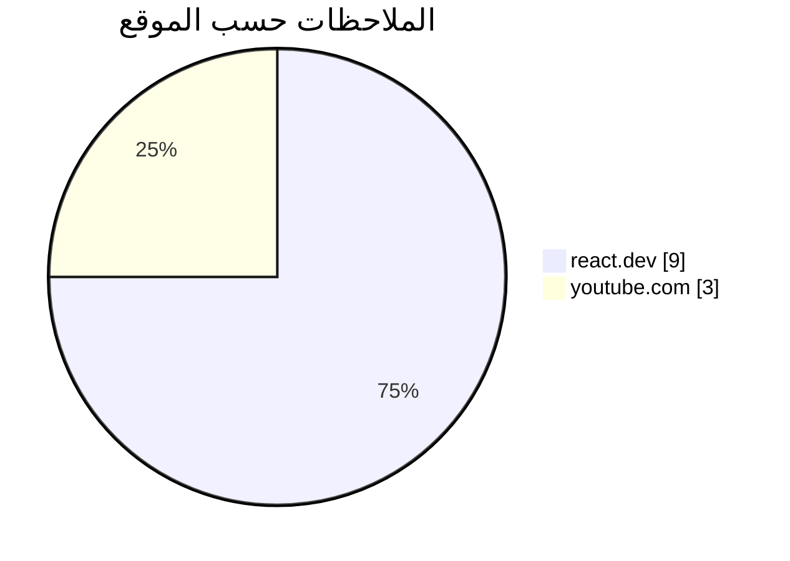

# هامش

التصدير مرة أخرى يستبدل الملفات داخل `Hamesh/`. اكتب ملاحظاتك الخاصة خارجه، واربطها به.

6 صفحات · 12 ملاحظة

## أين ملاحظاتك

## الصفحات

| الصفحة | الموقع | طريقة العرض | الملاحظات | آخر ملاحظة |
|---|---|---|---|---|
| [صيد كاست 13 – حوار جريء](Sites/youtube.com/%D8%B5%D9%8A%D8%AF%20%D9%83%D8%A7%D8%B3%D8%AA%2013%20%D8%AD%D9%88%D8%A7%D8%B1%20%D8%AC%D8%B1%D9%8A%D8%A1.md) | youtube.com | خط زمني | 1 | 2026-11-07 |
| [Lifecycle of Reactive Effects – React](Sites/react.dev/Lifecycle%20of%20Reactive%20Effects%20%E2%80%93%20React.md) | react.dev | ملاحظات | 6 | 2026-08-22 |
| [Referencing Values with Refs – React](Sites/react.dev/Referencing%20Values%20with%20Refs%20%E2%80%93%20React.md) | react.dev | قاموس | 2 | 2026-08-22 |
| [useState – React](Sites/react.dev/useState%20%E2%80%93%20React.md) | react.dev | ملاحظات | 1 | 2026-08-22 |
| [لو بتفكر تسافر , شوف الفيديو دا الأول ! – ضيف](Sites/youtube.com/%D9%84%D9%88%20%D8%A8%D8%AA%D9%81%D9%83%D8%B1%20%D8%AA%D8%B3%D8%A7%D9%81%D8%B1%20%2C%20%D8%B4%D9%88%D9%81%20%D8%A7%D9%84%D9%81%D9%8A%D8%AF%D9%8A%D9%88%20%D8%AF%D8%A7%20%D8%A7%D9%84%D8%A3%D9%88%D9%84%20!%20%D8%B6%D9%8A%D9%81.md) | youtube.com | خط زمني | 1 | 2026-08-22 |
| [المناظرة الكبرى : سؤال كبير؟](Sites/youtube.com/%D8%A7%D9%84%D9%85%D9%86%D8%A7%D8%B8%D8%B1%D8%A9%20%D8%A7%D9%84%D9%83%D8%A8%D8%B1%D9%89%20%D8%B3%D8%A4%D8%A7%D9%84%20%D9%83%D8%A8%D9%8A%D8%B1%D8%9F.md) | youtube.com | خط زمني | 1 | 2026-08-22 |

## الفولدرات

- [English - Vocab](Folders/English%20-%20Vocab.md) · 5 ملاحظات
- [Learning](Folders/Learning.md) · 4 ملاحظات
  - [React](Folders/Learning/React.md) · 4 ملاحظات
- [Youtube](Folders/Youtube.md) · ملاحظتان
  - [Podcasts Notes](Folders/Youtube/Podcasts%20Notes.md) · ملاحظتان

الملف `Hamesh notes.csv` فيه كل الملاحظات. استورده وحده في Notion ليصبح قاعدة بيانات ترتّبها وتفلترها.

---

*صُدِّرت من [هامش](https://hamesh.fandees.tech) · 20 نوفمبر 2026*
