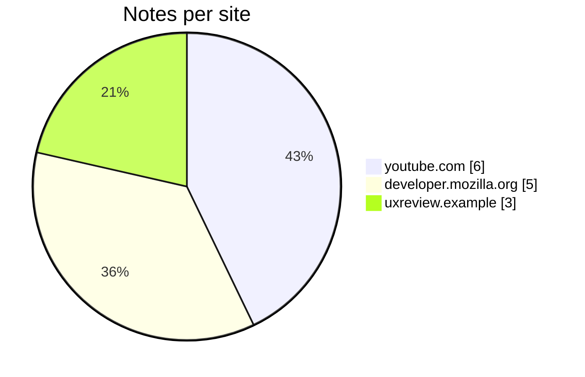

# Hamesh

> [!warning] This folder belongs to the export
> Exporting again replaces the files in `Hamesh/`. Keep your own writing outside it, and link in.

## Where your notes are

## Pages

| Page                                  | Site                  | Kind    | Notes | Last written |
| ------------------------------------- | --------------------- | ------- | ----- | ------------ |
| [[مقدمة في الخوارزميات — المحاضرة 3]] | youtube.com           | video   | 6     | 2026-11-18   |
| [[Using the Fetch API]]               | developer.mozilla.org | article | 5     | 2026-11-09   |
| [[Checkout — step 2]]                 | uxreview.example      | mixed   | 3     | 2026-10-30   |

## Folders

- [[Algorithms]] · 1 page
- [[Work/Frontend]] · 1 page
- [[Work/Reviews]] · 1 page

All notes as a live table: ![[Hamesh notes.base]]

---

<small>Exported from [Hamesh](https://hamesh.fandees.tech) · 20 November 2026</small>
