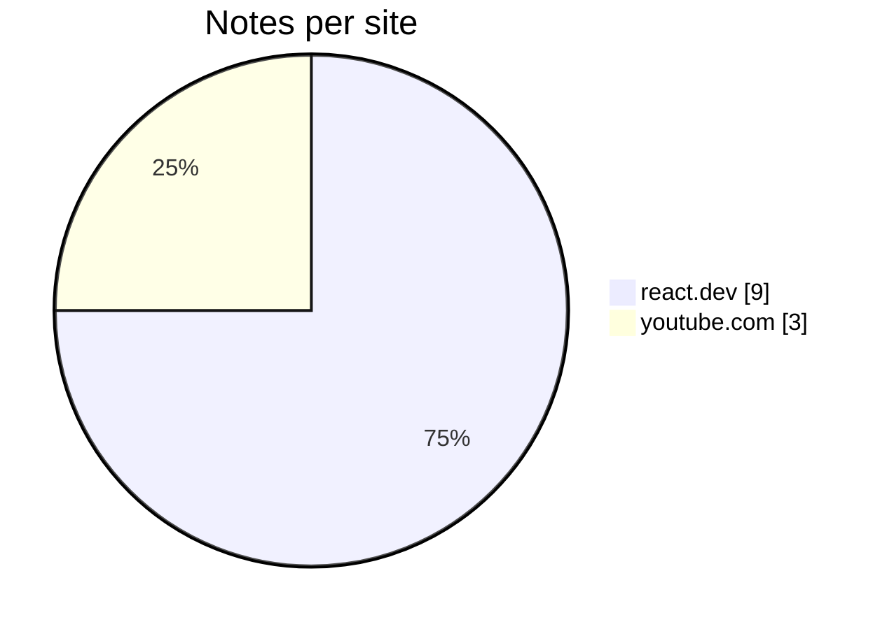

# Hamesh

> [!warning] This folder belongs to the export
> Exporting again replaces the files in `Hamesh/`. Keep your own writing outside it, and link in.

6 pages · 12 notes

## Where your notes are

## Pages

| Page | Site | Layout | Notes | Last written |
|---|---|---|---|---|
| [[Hamesh/Sites/youtube.com/صيد كاست 13 حوار جريء\|صيد كاست 13 – حوار جريء]] | youtube.com | Timeline | 1 | 2026-11-07 |
| [[Hamesh/Sites/react.dev/Lifecycle of Reactive Effects – React\|Lifecycle of Reactive Effects – React]] | react.dev | Notes | 6 | 2026-08-22 |
| [[Hamesh/Sites/react.dev/Referencing Values with Refs – React\|Referencing Values with Refs – React]] | react.dev | Glossary | 2 | 2026-08-22 |
| [[Hamesh/Sites/react.dev/useState – React\|useState – React]] | react.dev | Notes | 1 | 2026-08-22 |
| [[Hamesh/Sites/youtube.com/لو بتفكر تسافر , شوف الفيديو دا الأول ! ضيف\|لو بتفكر تسافر , شوف الفيديو دا الأول ! – ضيف]] | youtube.com | Timeline | 1 | 2026-08-22 |
| [[Hamesh/Sites/youtube.com/المناظرة الكبرى سؤال كبير؟\|المناظرة الكبرى : سؤال كبير؟]] | youtube.com | Timeline | 1 | 2026-08-22 |

## Folders

- [[Hamesh/Folders/English - Vocab|English - Vocab]] · 5 notes
- [[Hamesh/Folders/Learning|Learning]] · 4 notes
  - [[Hamesh/Folders/Learning/React|React]] · 4 notes
- [[Hamesh/Folders/Youtube|Youtube]] · 2 notes
  - [[Hamesh/Folders/Youtube/Podcasts Notes|Podcasts Notes]] · 2 notes

## Every page as a live table

![[Hamesh/Hamesh notes.base]]

---

*Exported from [Hamesh](https://hamesh.fandees.tech) · 20 November 2026*
