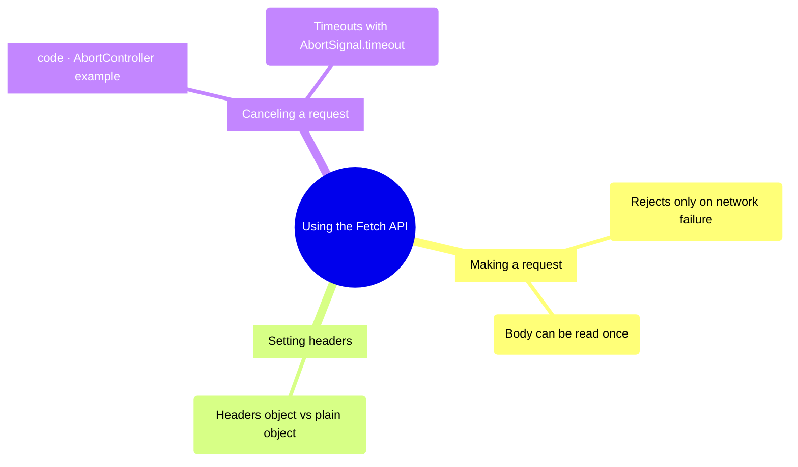

# Using the Fetch API

> [!info] Hamesh
> [Open the page](https://developer.mozilla.org/en-US/docs/Web/API/Fetch_API/Using_Fetch) · 5 notes · last written 9 November 2026
> On the canvas: [[Using the Fetch API.canvas]]

## Map of the page

## At a glance

| #   | Section             | On         | Note                              |
| --- | ------------------- | ---------- | --------------------------------- |
| 1   | Making a request    | words      | Rejects only on network failure   |
| 2   | Making a request    | words      | Body can be read once             |
| 3   | Setting headers     | words      | Headers object vs plain object    |
| 4   | Canceling a request | code block | AbortController example           |
| 5   | Canceling a request | words      | Timeouts with AbortSignal.timeout |

## Making a request

> [!quote] On the page
> the promise only rejects when the request itself fails

A 404 still resolves. Always check `response.ok` before `.json()`. ^hm-01jb2a

> [!quote] On the page
> a response body is a stream and can be consumed only once

Need it twice? `response.clone()` before reading. ^hm-01jb2c

## Setting headers

> [!quote] On the page
> you can pass a Headers object or an object literal

Headers object normalises names to lower case. Matters when I merge defaults in our client. ^hm-01jb3f

## Canceling a request

> [!example] On a code block
> `pre` · "const controller = new AbortController()…"

Use this pattern in the search box: abort the previous request on every keystroke. ^hm-01jb4d

> [!quote] On the page
> AbortSignal.timeout() returns a signal that aborts after a set time

Cleaner than a setTimeout + abort pair. Check Safari support before using it. ^hm-01jb4k

---

<small>Exported from [Hamesh](https://hamesh.fandees.tech) · 20 November 2026</small>
