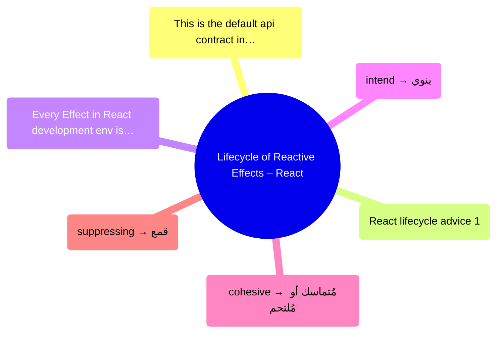

# Lifecycle of Reactive Effects – React

> [!info] Hamesh
> [Open the page](https://react.dev/learn/lifecycle-of-reactive-effects) · 6 notes · last written 22 August 2026
> On the canvas: [[Hamesh/Sites/react.dev/Lifecycle of Reactive Effects – React.canvas|Lifecycle of Reactive Effects – React]]

## Map of the page

## At a glance

| # | On | Note |
|---|---|---|
| 1 | connection.disconnect(); | This is the default api contract in useEffect: useEffect should only return… |
| 2 | When you looked from the component’s perspective, it was… | React lifecycle advice #1 |
| 3 | React starts and stops your Effect one extra time in… | Every Effect in React development env is done twice |
| 4 | intend | ينوي |
| 5 | cohesive | مُتماسك أو مُلتحم |
| 6 | suppressing | قمع |

## Notes

> [!quote] On the page
> connection.disconnect();

This is the default api contract in useEffect: useEffect should only return undefined or a function. ^hm-ncleanup

> [!quote] On the page
> When you looked from the component’s perspective, it was tempting to think of Effects as callbacks.

React lifecycle advice #1 ^hm-nadvice

> [!quote] On the page
> React starts and stops your Effect one extra time in development

Every Effect in React development env is done twice ^hm-ntwice

> [!quote] On the page
> intend

ينوي ^hm-nintend

> [!quote] On the page
> cohesive

مُتماسك أو مُلتحم ^hm-ncohesiv

> [!quote] On the page
> suppressing

قمع ^hm-nsuppres

---

*Exported from [Hamesh](https://hamesh.fandees.tech) · 20 November 2026*
